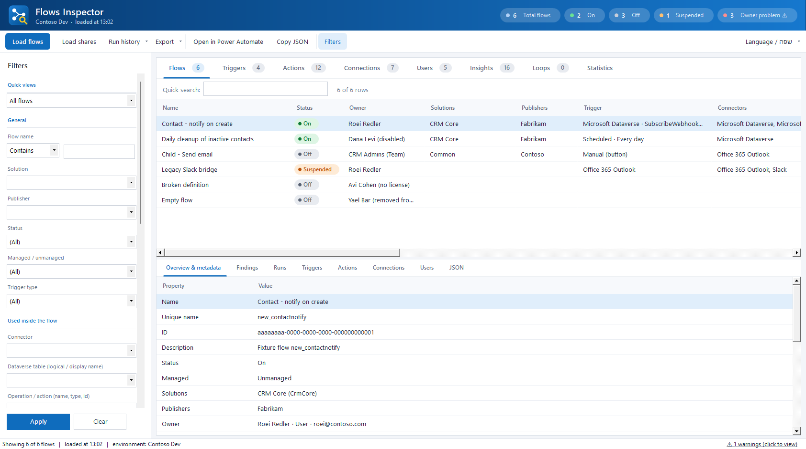
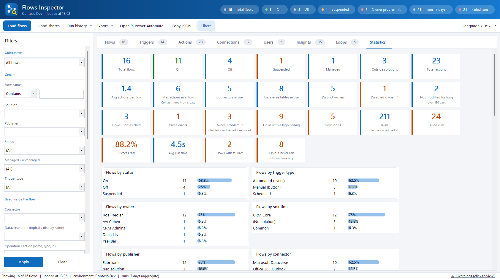
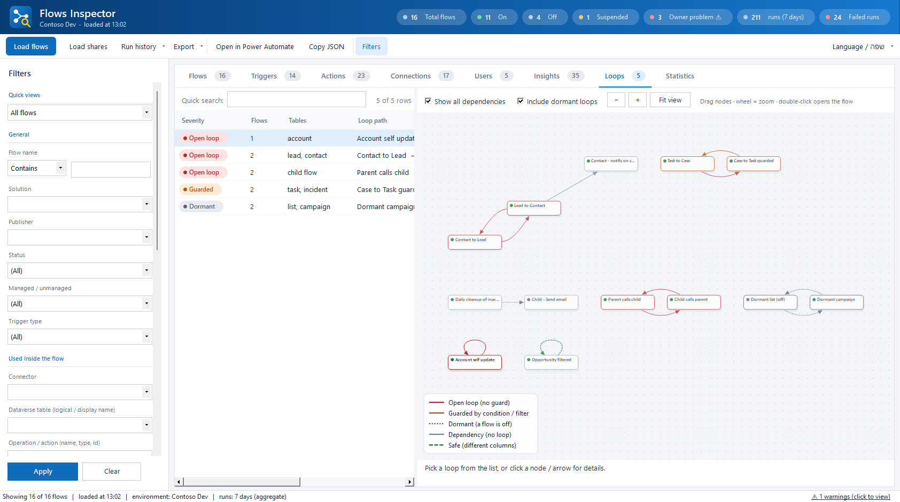
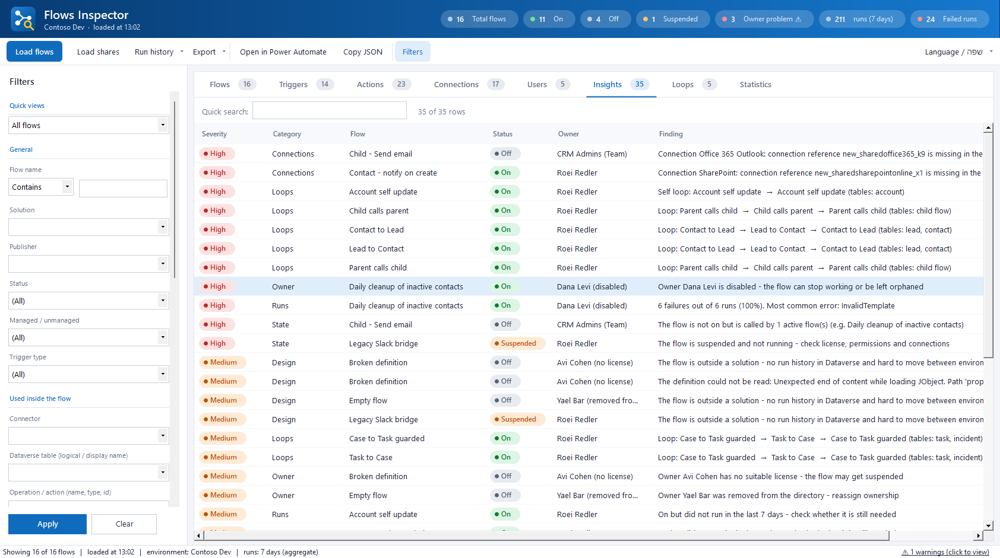
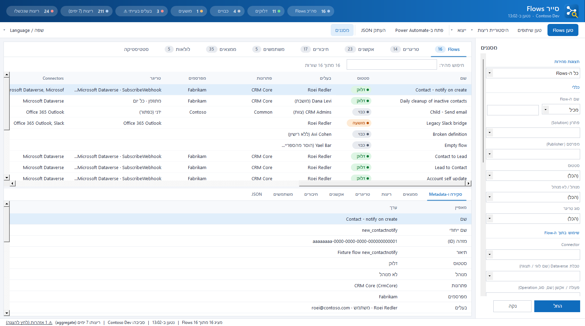

# Flows Inspector for XrmToolBox · סייר Flows

An [XrmToolBox](https://www.xrmtoolbox.com) tool that reads **every cloud flow** in a Dataverse environment and shows what is inside: triggers, actions, connections, users, run history, health findings and loops between flows. **The UI is available in full Hebrew (right-to-left) and English** - switch with the *Language* menu.

The tool is **read-only**. It never creates, changes, turns on/off or deletes a flow, and no data leaves your machine.

## What you get

| Area | What it shows |
|---|---|
| **Flows** | One row per flow: status (on / off / suspended), owner and the owner's account state, solutions and publishers, trigger summary, connectors, Dataverse tables, action count, runs, failures, last modified. A details pane shows the metadata, findings, run days and the raw JSON. |
| **Triggers / Actions** | Every trigger and action of every flow, including nested ones (conditions, scopes, loops, switch). Shows connector, operation, target table / SharePoint site and list / URL / child flow. |
| **Connections** | Connection references per flow, whether they exist in the environment, their owner and state. |
| **Users** | Owner, creator, modifier, connection owners and (optionally) co-owners, with a per-user summary. |
| **Insights** | Automatic findings ranked high / medium / info (see below). |
| **Loops** | An interactive map of flows that trigger each other in a loop. |
| **Statistics** | KPIs and ranked lists: flows by owner, solution, publisher, connector, table; runs and failures from the largest to the smallest; failure rate; slowest flows; runs and failures per day; common failure reasons; flow size; external hosts. |

### Filters

Name (starts with, contains, equals, ends with, does not contain, regex) · solution · publisher · owner · created / modified by · status · managed / unmanaged · trigger type · connector · **Dataverse table** (logical name, entity set name or display name all match) · operation or action name · target (SharePoint site / list, URL, child flow) · connection reference or connection id · modified dates · minimum actions · minimum runs / failures / failure % · free text inside the flow definition.

The connector, table, operation and target filters work together **per action or trigger**, so *Dataverse + contact + DeleteRecord* finds flows that delete contacts, not flows that merely use Dataverse and mention contact somewhere else.

*Quick views* apply common filters in one click: flows with high-severity findings, owner problems, flows inside a loop, on flows that never ran, failing flows, suspended flows, flows outside solutions, large flows.

## Run history

Use **Run history** in the toolbar and pick a period (1 to 28 days; Dataverse keeps run history for 28 days by default). The tool reads the Dataverse `flowrun` table with one aggregate query per day. If a day holds more than the 50,000-row aggregate limit it is split in smaller time windows automatically; if the aggregate query is not available it falls back to reading rows page by page (capped at 300,000 rows, and the status bar says when numbers are partial).

Run history exists only for **solution-aware flows**. Flows outside a solution are shown without run numbers.

## Owner license and disabled users

For every owner the tool checks `isdisabled`, `islicensed` and `azuredeletedon`:

* **disabled** - the user was disabled;
* **no license** - the user is not licensed (application users and non-interactive users do not need a license and are not flagged);
* **removed from directory** - the user was soft-deleted from Microsoft Entra ID.

Flows of such owners appear as findings (high when the flow is on), in the owner column, in the header counters, and in the *Owner disabled / unlicensed / removed* quick view. Note that Dataverse only knows whether the user is licensed for Dataverse; it cannot tell which Power Automate license plan the user has.

## Loops between flows

A loop is a cycle of flows where each one starts the next. The tool builds a graph:

* flow A **creates / updates / deletes a row** in table *T* (a Dataverse *Add a new row*, *Update a row*, *Delete a row* action) and flow B has a Dataverse trigger on table *T* that listens to that event (*when a row is added / modified / deleted*);
* flow A **runs flow B as a child flow**.

Then it finds every cycle, including a flow that triggers itself (for example *When a row is modified* on `account` that updates `account`).

* **Open loop (red)** - no condition on the way: it will keep running.
* **Guarded (orange)** - the write sits inside an *If / Switch*, or the trigger has a filter expression: check that it really stops the loop.
* **Dormant (dotted gray)** - one of the flows in the loop is off.
* **Safe (green dashed, shown with *Show all dependencies*)** - the trigger only listens to specific columns and the action writes none of them.

Drag nodes, scroll to zoom, drag the background to pan, click a node or arrow to read what it does, double-click a flow to open it. Select a loop in the list to highlight it.

This is a static analysis of the flow definitions. It cannot evaluate expressions or know what a condition does at run time, so treat *Guarded* as "needs a look".

## Insights

Examples of findings: owner disabled / unlicensed / removed · flow suspended · child flow that is off but still called · connection reference missing or inactive in the environment · flow outside a solution · high failure rate · on flow with no runs · very large or deeply nested flow · no failure handling (*run after: has failed*) · hard-coded e-mail addresses, SharePoint sites and external hosts · not modified for a long time · duplicate names · no co-owner (after *Load shares*) · loops.

## Using it

1. Open **Flows Inspector** from the XrmToolBox tool list and connect to an environment.
2. Click **Load flows**.
3. Optional: **Run history** for run statistics, **Load shares** for co-owners (one call per flow, so use it on a filtered set).
4. Filter, switch tabs, double-click rows to jump to a flow. Export the full report or the current tab from **Export** (Excel, CSV).

## Privileges needed

Read access to: `workflow` (cloud flows incl. their definition), `solution`, `solutioncomponent`, `publisher`, `systemuser`, `team`, `connectionreference`, `flowrun` (only for run history), and table metadata. *Load shares* additionally uses the *retrieve shared principals and access* message. A System Administrator has all of these.

## Limitations

* Only cloud flows (category *Modern Flow*) are read; desktop flows are not included.
* Connections are shown through their *connection references*; the identity behind a personal connection is not stored in Dataverse.
* Loop detection and findings are heuristics based on the flow definitions.

## Requirements

XrmToolBox 1.2026.9.78 or later (.NET Framework 4.8).

---

# סייר Flows (עברית)

כלי ל-XrmToolBox שקורא את **כל ה-Cloud Flows** בסביבת Dataverse ומראה מה יש בתוכם: טריגרים, אקשנים, חיבורים, משתמשים, היסטוריית ריצות, ממצאי בריאות ולולאות בין Flows. **הממשק זמין בעברית מלאה (מימין לשמאל) ובאנגלית** - ההחלפה בתפריט *שפה / Language*.

הכלי **לקריאה בלבד**: הוא אינו יוצר, משנה, מדליק, מכבה או מוחק Flow, ושום מידע לא יוצא מהמחשב שלך.

## מה יש בכלי

* **Flows** - שורה לכל Flow: סטטוס, בעלים ומצב החשבון שלו, פתרונות ומפרסמים, טריגר, Connectors, טבלאות Dataverse, מספר אקשנים, ריצות וכשלונות. חלונית פרטים עם Metadata, ממצאים, ריצות לפי יום ו-JSON.
* **טריגרים ואקשנים** - כל הטריגרים והאקשנים של כל ה-Flows, כולל מקוננים, עם Connector, Operation ויעד (טבלה / אתר ורשימה ב-SharePoint / URL / Flow בן).
* **חיבורים** - Connection References לכל Flow, האם קיימים בסביבה, בעלים ומצב.
* **משתמשים** - בעלים, יוצר, מעדכן, בעלי חיבורים ושיתופים.
* **ממצאים** - כללים אוטומטיים בדרגות קריטי / בינוני / מידע.
* **לולאות** - מפה אינטראקטיבית של Flows שמפעילים זה את זה בלולאה.
* **סטטיסטיקה** - דירוגים מהגדול לקטן: ריצות, כשלונות, אחוז כשל, זמן ריצה, ריצות וכשלונות לפי יום, סיבות כשל, וגם התפלגות לפי בעלים, פתרון, מפרסם, Connector וטבלה.

## סינון

שם (מתחיל ב / מכיל / שווה / מסתיים ב / Regex) · פתרון · מפרסם · בעלים · סטטוס · מנוהל או לא · סוג טריגר · Connector · **טבלת Dataverse** · פעולה · יעד · Connection Reference · תאריכים · מינימום ריצות / כשלונות / אחוז כשל · חיפוש חופשי בתוך ההגדרה. מסנני Connector, טבלה, פעולה ויעד פועלים יחד **על אותו אקשן או טריגר**. יש גם *תצוגות מהירות* בלחיצה.

## בעלים ללא רישיון או משתמש שבוטל

לכל בעלים נבדק אם הוא **מושבת**, **ללא רישיון** או **הוסר מהספרייה (Entra ID)**. משתמשי אפליקציה ומשתמשים שאינם אינטראקטיביים לא צריכים רישיון ולא מסומנים. Dataverse יודע רק אם למשתמש יש רישיון Dataverse, ולא איזו תוכנית Power Automate יש לו.

## לולאות בין Flows

לולאה היא מעגל שבו כל Flow מפעיל את הבא: אקשן שיוצר / מעדכן / מוחק שורה בטבלה, וטריגר של Flow אחר על אותה טבלה ואותו אירוע (למשל יצירת contact יוצרת lead ו-FLOW2 על יצירת lead יוצר contact), או קריאה ל-Flow בן. הכלי מוצא גם לולאה עצמית. אדום = ללא הגנה, כתום = מוגנת בתנאי (לבדיקה ידנית), מקווקו אפור = רדומה (Flow כבוי).

זו בדיקה סטטית של ההגדרות: הכלי לא יודע מה תנאי עושה בזמן ריצה.

## שימוש

1. פתח את **Flows Inspector** ב-XrmToolBox והתחבר לסביבה.
2. לחץ **טען Flows**.
3. אופציונלי: **היסטוריית ריצות** לסטטיסטיקת ריצות, **טען שיתופים** לבעלים נוספים.
4. סנן, עבור בין לשוניות, וייצא ל-Excel / CSV מהתפריט **ייצוא**.

היסטוריית ריצות קיימת רק ל-Flows שנמצאים בתוך פתרון, ו-Dataverse שומר אותה 28 יום כברירת מחדל.

## הרשאות

קריאה בטבלאות `workflow`, `solution`, `solutioncomponent`, `publisher`, `systemuser`, `team`, `connectionreference`, `flowrun` (להיסטוריית ריצות) ומטא-דאטה של טבלאות. System Administrator מכסה הכל.
